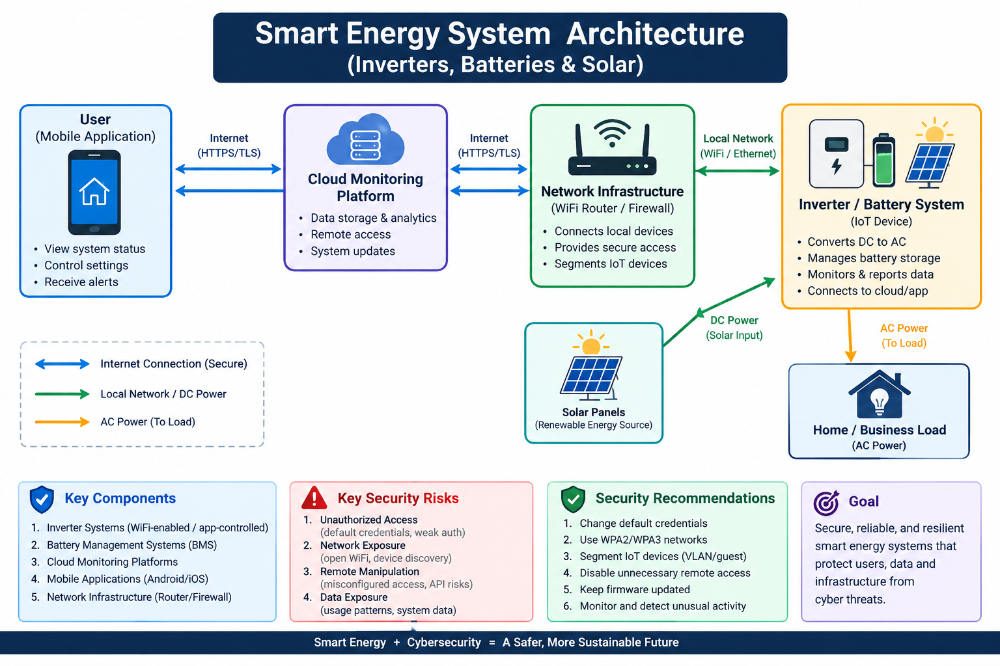
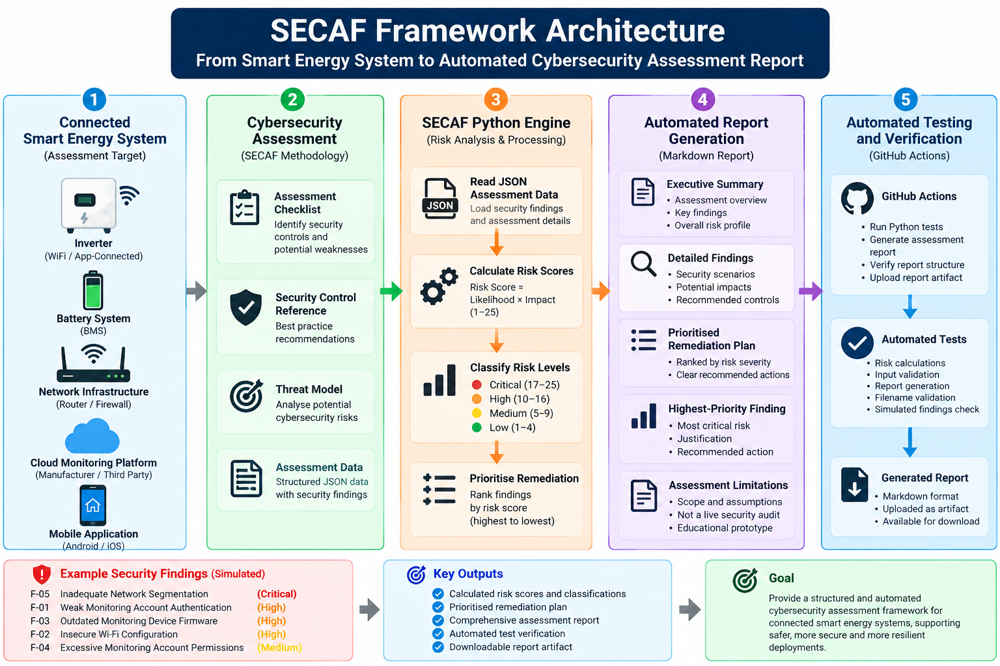

# Securing Smart Energy Systems
## A Cybersecurity Assessment Framework for Connected Inverters, Batteries and Solar Energy Systems

[](https://github.com/Effiong-Okon-Antai/secure-smart-energy-systems/actions/workflows/secaf-tests.yml)

**Project:** Smart Energy Cybersecurity Assessment Framework (SECAF)  
**Framework Version:** 1.1  
**Developer:** Effiong Okon Antai  
**Technology:** Python, JSON, Markdown, GitHub Actions  
**Focus:** Cybersecurity Risk Assessment, IoT Security, Smart Energy Systems

---

## 1. Project Overview

Modern smart energy systems increasingly rely on internet connectivity, mobile applications, wireless communication and cloud-based monitoring platforms.

Hybrid solar inverters, lithium battery storage systems and related monitoring devices can be connected to home or enterprise networks, enabling users to monitor energy production, battery performance, electricity consumption and system operating conditions remotely.

Although these capabilities improve accessibility and operational efficiency, they also introduce cybersecurity considerations.

Weak authentication, insecure wireless networks, outdated firmware, excessive account permissions and inadequate network segmentation may increase exposure to security threats.

The **Smart Energy Cybersecurity Assessment Framework (SECAF)** was developed to provide a structured approach to identifying, evaluating, documenting and prioritising cybersecurity risks in connected smart-energy environments.

The project combines cybersecurity assessment methodology with Python-based risk calculations, structured assessment data and automated report generation.

---

## 2. Project Objectives

SECAF aims to:

1. Identify potential cybersecurity risks affecting connected smart-energy systems.
2. Provide a structured cybersecurity assessment methodology.
3. Evaluate security findings using likelihood and impact ratings.
4. Calculate and classify cybersecurity risk scores automatically.
5. Generate structured cybersecurity assessment reports.
6. Recommend appropriate security controls.
7. Prioritise remediation activities according to calculated risk severity.
8. Demonstrate automated software testing and report verification.

The framework is designed as an educational and technical prototype that could support further research and development in smart-energy cybersecurity.

---

## 3. System Architecture

A typical connected smart-energy environment may include:

- Hybrid solar inverter
- Lithium battery storage system
- Battery Management System (BMS)
- Wi-Fi monitoring dongle
- Home or enterprise wireless router
- Cloud monitoring platform
- Mobile monitoring application
- Remote monitoring and configuration interfaces

These components may exchange operational information across local networks and external cloud services.

Understanding the relationships between these components is important when identifying potential cybersecurity risks.
## System Architecture

This project includes two complementary architecture diagrams.

### 1. Smart Energy System Architecture

The diagram below illustrates how connected smart-energy
systems interact with network infrastructure, cloud monitoring
platforms, and mobile applications.



### 2. SECAF Cybersecurity Assessment Framework Architecture

The diagram below illustrates the technical workflow of the
Smart Energy Cybersecurity Assessment Framework (SECAF).

It demonstrates how structured cybersecurity findings are
processed through Python-based risk scoring, risk classification,
remediation prioritisation, automated report generation,
and GitHub Actions verification.



**Framework capabilities:**

- Structured cybersecurity assessment using JSON data
- Automated likelihood and impact risk calculations
- Risk classification and prioritisation
- Generation of Markdown assessment reports
- Automated software testing using GitHub Actions
- Downloadable assessment reports as workflow artifacts

**Assessment scope:** The current implementation uses
simulated smart-energy cybersecurity findings. It does not
represent a live penetration test or independent security
certification of commercial equipment.
**Architecture Diagram:** [View Smart Energy System Architecture](architecture-diagram.png)

---

## 4. Cybersecurity Threat Model

SECAF considers several categories of potential security weaknesses.

### 4.1 Authentication and Access Control

Potential concerns include:

- Weak or default passwords
- Shared monitoring accounts
- Excessive user permissions
- Inadequate authentication controls

### 4.2 Wireless Network Security

Potential concerns include:

- Weak wireless encryption
- Insecure router configurations
- Unnecessary network exposure
- Poorly secured monitoring devices

### 4.3 Firmware and Device Security

Potential concerns include:

- Outdated device firmware
- Unsupported firmware versions
- Unnecessary device services
- Inadequate firmware management procedures

### 4.4 Cloud and Mobile Application Security

Potential concerns include:

- Insecure remote access
- Weak account authentication
- Excessive application permissions
- Exposure of monitoring information

### 4.5 Network Segmentation

Potential concerns include:

- Smart-energy devices sharing unrestricted network access with other systems
- Unnecessary communication between connected devices
- Inadequate separation of IoT equipment from sensitive network resources

**Threat Model Documentation:** [View Threat Model](threat-model.md)

---

## 5. Smart Energy Cybersecurity Assessment Framework (SECAF)

SECAF provides a structured methodology for assessing cybersecurity risks associated with connected energy systems.

Its main components include:

| Component | Purpose |
|---|---|
| Assessment methodology | Defines the cybersecurity assessment process |
| Assessment checklist | Identifies relevant security controls and potential weaknesses |
| Control reference | Documents security control considerations |
| Risk-scoring methodology | Defines likelihood, impact and risk classification |
| Python risk calculator | Calculates and classifies cybersecurity risks |
| JSON assessment data | Stores structured assessment findings |
| Automated report generator | Produces cybersecurity assessment reports |
| Automated testing | Validates selected software functions |
| GitHub Actions | Runs tests and report verification automatically |

**Framework Documentation:** [Explore SECAF](SECAF/README.md)

---

## 6. Cybersecurity Risk-Scoring Methodology

SECAF evaluates cybersecurity findings using two factors:

**Likelihood:** The estimated probability or plausibility of a security event.

**Impact:** The potential consequences if the security event occurs.

Each factor is assigned a value between 1 and 5.

### Risk Calculation

**Risk Score = Likelihood × Impact**

The resulting score ranges from 1 to 25.

| Risk Score | Risk Classification |
|---|---|
| 1–4 | Low |
| 5–9 | Medium |
| 10–16 | High |
| 17–25 | Critical |

The Python risk calculator automates these calculations and validates the permitted input values.

**Implementation:** [Python Risk Calculator](SECAF/risk-calculator.py)

**Methodology:** [Risk-Scoring Documentation](SECAF/risk-scoring.md)

---

## 7. Simulated Smart Inverter Cybersecurity Assessment

A simulated smart-energy environment was developed to demonstrate the practical application of SECAF.

The fictional environment includes a hybrid inverter, battery storage, wireless monitoring equipment, a network router and a mobile monitoring platform.

Five hypothetical security findings were evaluated.

| Finding | Security Concern | Risk Score | Classification |
|---|---|---:|---|
| F-01 | Weak monitoring account authentication | 16 | High |
| F-02 | Insecure Wi-Fi configuration | 12 | High |
| F-03 | Outdated monitoring device firmware | 15 | High |
| F-04 | Excessive monitoring account permissions | 9 | Medium |
| F-05 | Inadequate network segmentation | 20 | Critical |

The assessment demonstrates how SECAF calculates risk scores, classifies findings and determines remediation priorities.

**Simulated Assessment:** [View Assessment](SECAF/simulated-smart-inverter-assessment.md)

**Structured Assessment Data:** [View JSON Assessment](SECAF/simulated-assessment.json)

### Important Limitation

All assessment findings are hypothetical.

The project does not claim that these vulnerabilities exist in any specific commercial inverter, battery system, monitoring application or manufacturer's infrastructure.

No unauthorised testing, penetration testing or exploitation of real customer systems was performed as part of this demonstration.

---

## 8. Automated Cybersecurity Assessment Report Generation

SECAF includes a Python-based report generator that processes structured assessment data and produces a Markdown cybersecurity assessment report.

The report generator is designed to:

1. Read cybersecurity findings from JSON assessment data.
2. Calculate risk scores.
3. Assign risk classifications.
4. Generate an executive summary.
5. Present detailed security findings.
6. Describe simulated security scenarios and potential impacts.
7. Recommend security controls.
8. Rank findings according to calculated risk severity.
9. Generate a prioritised remediation plan.
10. Document the assessment's limitations.

**Report Generator:** [View Python Implementation](SECAF/generate-assessment-report.py)

### Automated Remediation Prioritisation

SECAF ranks findings according to their calculated risk scores.

For the simulated assessment, the resulting priority order is:

| Priority | Finding | Risk |
|---|---|---|
| 1 | F-05 — Inadequate Network Segmentation | Critical |
| 2 | F-01 — Weak Authentication | High |
| 3 | F-03 — Outdated Firmware | High |
| 4 | F-02 — Insecure Wi-Fi | High |
| 5 | F-04 — Excessive Permissions | Medium |

This functionality demonstrates how structured cybersecurity assessment data can be transformed into prioritised recommendations.

---

## 9. Automated Testing and Continuous Integration

SECAF includes automated Python tests executed through GitHub Actions.

The automated testing process covers selected aspects of:

- Risk calculation and classification
- Input validation
- Risk-scoring boundaries
- Markdown report generation
- Report filename validation
- Overwrite protection
- Simulated assessment verification

The GitHub Actions workflow also generates and verifies a cybersecurity assessment report.

After successful execution, the generated report is uploaded as a workflow artifact.

### Verified Workflow

**Successful GitHub Actions Run:** [SECAF Automated Tests — Run #21](https://github.com/Effiong-Okon-Antai/secure-smart-energy-systems/actions/runs/40121314791)

**Testing Documentation:** [SECAF Testing](SECAF/TESTING.md)

**Workflow Configuration:** [GitHub Actions](.github/workflows/secaf-tests.yml)

The automated tests validate implemented software behaviour and selected report-generation requirements.

They do not constitute independent cybersecurity certification or verification of real-world smart-energy equipment.

---

## 10. Project Structure

The repository includes the following components:

```text
secure-smart-energy-systems/
│
├── README.md
├── LICENSE
├── architecture-diagram.png
├── threat-model.md
│
├── .github/
│   └── workflows/
│       └── secaf-tests.yml
│
└── SECAF/
    ├── README.md
    ├── TESTING.md
    ├── methodology.md
    ├── assessment-checklist.md
    ├── assessment-template.md
    ├── control-reference.md
    ├── risk-scoring.md
    ├── risk-calculator.py
    ├── generate-assessment-report.py
    ├── simulated-assessment.json
    ├── simulated-smart-inverter-assessment.md
    ├── test_risk_calculator.py
    ├── test_report_generation.py
    └── test_simulated_assessment.py
```

This structure separates the assessment methodology, implementation, demonstration data and automated testing components.

---

## 11. Technical Contributions

The project demonstrates the development and integration of several cybersecurity and software engineering components.

These include:

**Cybersecurity Assessment Design**

Development of a structured approach to assessing potential security weaknesses in connected smart-energy environments.

**Risk-Scoring Implementation**

Implementation of Python-based likelihood and impact calculations, input validation and risk classification.

**Structured Assessment Data**

Use of JSON to represent hypothetical cybersecurity findings in a machine-readable format.

**Automated Report Generation**

Development of a Python report generator that converts assessment data into a structured cybersecurity report.

**Remediation Prioritisation**

Implementation of automated ranking of security findings according to calculated risk severity.

**Software Testing and Automation**

Integration of Python tests and GitHub Actions to support repeatable validation and automated report generation.

These components form a working prototype for further development and evaluation.

---

## 12. Future Development

Potential future improvements include:

- Expanding the framework to support additional smart-energy device categories.
- Moving security scenario descriptions into configurable assessment data.
- Improving report-generation flexibility.
- Developing additional automated software tests.
- Integrating recognised cybersecurity control frameworks.
- Supporting controlled, authorised security assessments.
- Exploring integration with network monitoring and intrusion detection systems.
- Developing more advanced reporting and visualisation capabilities.

These features are proposed future work and are not presented as completed functionality.

---

## 13. Project Limitations

SECAF v1.1 is a technical prototype.

Its current limitations include:

- Demonstration using simulated assessment findings.
- No independent validation against commercial inverter hardware.
- No live penetration testing of customer infrastructure.
- Risk ratings based on illustrative assumptions.
- No formal third-party security certification.
- Limited assessment coverage compared with a complete enterprise security assessment.

These limitations are documented to distinguish demonstrated software functionality from future research and deployment possibilities.

---

## 14. Why This Project Matters

Connected smart-energy systems combine electrical infrastructure with software, wireless communication, cloud services and internet-connected devices.

As these technologies become more widely deployed, cybersecurity considerations become increasingly important.

SECAF explores how structured risk assessment and software automation can help document potential security weaknesses and support prioritised security improvements.

The project demonstrates an interdisciplinary approach combining cybersecurity knowledge, connected energy system concepts and practical software development.

---

## 15. Author

**Effiong Okon Antai**

MSc Cybersecurity — Nottingham Trent University  
BSc Computer Science

**Areas of Interest:**

- Cybersecurity
- IoT and Connected Device Security
- Smart Energy Systems
- Cybersecurity Risk Assessment
- Security Automation
- Digital Technology

**GitHub:** [Effiong-Okon-Antai](https://github.com/Effiong-Okon-Antai)

---

**Project Status:** Working Technical Prototype  
**Framework Version:** SECAF v1.1  
**Last Updated:** October 2026
